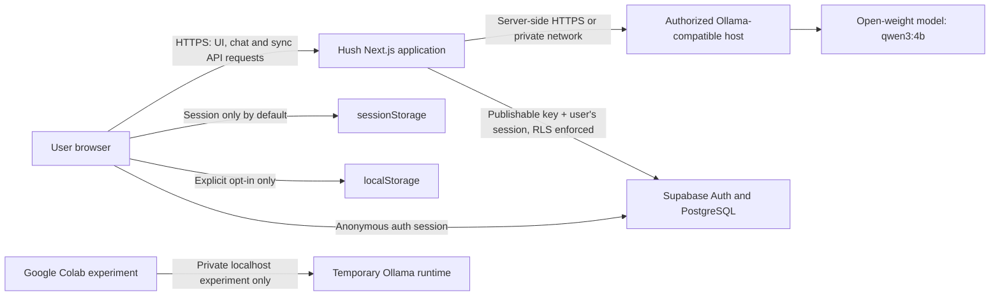

# Hush AI Architecture

**Status:** Canonical technical architecture  
**Product source of truth:** `PRD.md`  
**UI source of truth:** `DESIGN.md`  
**Scope:** Web-first MVP; anonymous Supabase identity with explicit opt-in conversation sync; no login/signup flow, commercial cloud-model fallback, or external telemetry

## 1. Architectural principles

1. **Open-weight inference only:** Hush communicates only with an authorized Ollama-compatible host. It must not integrate OpenAI, Gemini, or a paid cloud-model fallback.
2. **Server-side inference boundary:** Browsers call Hush API routes, never the Ollama endpoint directly. Model host URLs and tokens stay in server environment variables.
3. **Anonymous and minimal-data MVP:** Conversation state belongs in browser memory, `sessionStorage` by default, or explicit user-selected `localStorage`. Supabase writes occur only after a separate explicit Save action.
4. **Honest availability:** A deployed frontend without an eligible model host must report `configuration_missing`/service unavailable rather than fake a response.
5. **Simple extension path:** Keep route handlers, session logic, provider logic, and Supabase persistence separate so each service can be changed without moving provider calls into UI components.

## 2. Recommended technology stack

| Area | Choice | Reason |
| --- | --- | --- |
| Frontend framework | Next.js 15 App Router + React 19 + TypeScript | Existing, popular full-stack React foundation with server route handlers and streaming support. |
| Styling | Tailwind CSS 3 | Existing utility system; can encode the strict token system in `DESIGN.md` without introducing a second styling runtime. |
| UI icons | Lucide React | Existing accessible SVG icon set with broad coverage and no custom icon pipeline. |
| Client state | React hooks and `useReducer`/`useState` where complexity requires it | Conversation and Thought Trail state is local to one application surface; a global store is unnecessary for MVP. |
| Browser persistence | `sessionStorage` default, `localStorage` explicit opt-in | Keeps session-only use as the default; browser persistence is independent from optional Supabase sync. |
| Validation | Zod | Existing, well-documented schema validation for API input boundaries. |
| Markdown | `react-markdown` + `remark-gfm` | Existing, safe rendering path for model responses and code blocks. |
| Backend/API | Next.js Route Handlers (`app/api`) | Keeps the browser-to-model boundary in the same deployable application without a separate service. |
| Inference adapter | AI SDK OpenAI-compatible adapter pointed only at Ollama | Existing adapter supports server-side streaming while keeping model choice open-weight/Ollama compatible. |
| Model runtime | Ollama with `qwen3:4b` initially | Open-weight local/self-hostable runtime matching product constraints. |
| Optional transcript sync | Supabase Auth anonymous sessions + PostgreSQL `conversations` and `messages` tables, using `@supabase/ssr` and `@supabase/supabase-js` | Account-free identity and explicitly initiated, user-owned remote sync protected by RLS. |
| Sync encryption | Server-only Node.js AES-256-GCM adapter | Protects saved titles, trail names, and message content at rest from direct database reads; not end-to-end encryption. |
| Local experimentation | Google Colab notebook | Appropriate for temporary GPU/model experiments; explicitly not a production service endpoint. |
| Web hosting | Vercel for the Next.js application | Straightforward managed deployment for the frontend and route handlers; does not run Ollama itself. |
| Production inference hosting | Authorized self-hosted Ollama-compatible environment | Required for a Vercel deployment to reach a real model securely; must use TLS/authorization and never expose port `11434` publicly. |
| Database | Supabase-hosted PostgreSQL, explicit-save tables only | Anonymous identity and two existing tables are used only for user-requested save/load/delete; RLS is mandatory. |
| Testing | TypeScript, ESLint, Next production build; add Playwright in V2 | Existing checks are simple and reliable; browser automation becomes valuable after MVP interaction flows stabilize. |

## 3. System context



- The browser does **not** call Ollama directly.
- The Next.js application persists conversation data only after the user explicitly saves it to Supabase.
- Google Colab is isolated from the production data flow. It is not a Vercel inference endpoint and must not be exposed with an unauthorized tunnel/proxy.

## 4. Complete repository structure

```text
HUSH AI/
├── app/
│   ├── api/
│   │   ├── chat/
│   │   │   └── route.ts                 # Validated, rate-limited streaming chat endpoint
│   │   ├── health/
│   │   │   └── route.ts                 # Safe model/runtime state endpoint
│   │   └── conversations/
│   │       └── route.ts                 # Explicit-save, cookie-authenticated Supabase API
│   ├── globals.css                      # Global tokens, markdown, and layout styles
│   ├── layout.tsx                       # Root document metadata and fonts
│   └── page.tsx                         # Landing/workspace composition and UI orchestration
├── colab/
│   └── Hush-Ollama-Experiment.ipynb     # Temporary local Colab model experiment only
├── components/
│   ├── ChatComposer.tsx                 # Compose/send/stop UI
│   ├── ChatMessage.tsx                  # User/assistant markdown, actions, code copy
│   ├── LandingView.tsx                  # Empty-session landing experience
│   ├── PrivacyModal.tsx                 # Storage and privacy disclosure dialog
│   ├── StatusBadge.tsx                  # Runtime health status UI
│   ├── StyleSelector.tsx                # Four conversation style selector
│   ├── ThoughtTrailsSidebar.tsx         # Desktop inspector and mobile trail sheet
│   └── WorkspaceHeader.tsx              # Workspace title and global controls
├── hooks/
│   ├── use-hush-session.ts              # Session, streaming, retry, branching, browser persistence
│   └── use-supabase-conversations.ts    # Explicit remote save/load/delete UI state
├── lib/
│   ├── supabase/
│       ├── client.ts                    # Browser auth client and anonymous session
│       ├── server.ts                    # Cookie-aware server client
│       └── conversation-crypto.ts       # AES-256-GCM saved-field encryption
│   ├── ai.ts                            # Server-only Ollama-compatible provider/configuration
│   ├── storage.ts                       # Safe browser storage read/write/validation
│   └── styles.ts                         # Style metadata and server prompt instructions
├── scripts/
│   └── test-styles.js                   # Manual live Ollama style verification helper
├── types/
│   └── chat.ts                          # Shared domain and API-facing types
├── .env.example                         # Non-secret environment variable template
├── .gitignore                           # Secrets, generated output, model/runtime artifact exclusions
├── ARCHITECTURE.md                      # This document
├── DEPLOYMENT_CHECKLIST.md              # GitHub/Vercel and inference-host deployment steps
├── DESIGN.md                            # Canonical UI design system
├── PRD.md                               # Canonical product requirements
├── QA_CHECKLIST.md                      # Actual and pending verification status
├── README.md                            # Setup, operation, and product documentation
├── next.config.mjs                      # Next.js configuration
├── package.json                         # Scripts and dependencies
├── postcss.config.mjs                   # PostCSS configuration
├── tailwind.config.ts                   # Tailwind configuration
└── tsconfig.json                        # TypeScript configuration
```

Generated/dependency directories such as `.next/` and `node_modules/` are intentionally omitted.

## 5. Data flow

### 5.1 Initial load and health state

1. Browser loads `/` from the Next.js application.
2. `useHushSession` initializes an in-memory session, then safely hydrates validated data from the preferred browser store.
3. The browser calls `GET /api/health`.
4. The health route reads server-only Ollama configuration and checks the authorized Ollama host’s tags endpoint.
5. The route returns one of: `ready`, `configuration_missing`, `offline`, `model_missing`, or `error`.
6. `StatusBadge` and the workspace render the matching truthful state from `DESIGN.md`.

### 5.2 Streaming chat

1. User enters a prompt and selects one of four styles.
2. Browser session logic resolves the active Thought Trail lineage: ancestor messages through the branch anchor plus local trail messages only.
3. Browser sends a bounded JSON request to `POST /api/chat` with only user/assistant messages and selected style.
4. Route handler validates content type, JSON syntax, payload size, message roles/content/count, and style.
5. The server-side provider adds the approved style instruction and calls the configured Ollama-compatible host.
6. The route streams model text back to the browser.
7. The client incrementally updates the in-memory assistant message and UI.
8. Completion finalizes the response; cancellation aborts the browser request; failures create a clear error state without fabricated text.

### 5.3 Thought Trails

1. User selects Thought Trail on a completed assistant message.
2. Client creates a new local trail with `parentTrailId` and `parentMessageId`.
3. When the child receives a prompt, resolver includes only the parent lineage through the anchor message, then the child’s own turns.
4. Sibling branch turns are never included in the outgoing history.
5. Trail selection and renaming update browser-local session state only.

### 5.4 Browser persistence and reset

1. Default preference is `sessionStorage`.
2. User may explicitly choose `localStorage` in the privacy dialog.
3. Storage helpers validate session shape before hydration and gracefully handle unavailable/quota-limited storage.
4. The hook waits for hydration before writing, preventing an initial empty state from overwriting saved data.
5. Reset cancels active generation, removes session data from both stores, and creates a fresh in-memory session.

### 5.5 Explicit Supabase conversation sync

1. The browser Supabase client restores its cookie-backed session or creates an anonymous Supabase Auth user. There is no login/signup screen.
2. The browser continues to keep the active conversation in `sessionStorage` by default or `localStorage` only after local-storage opt-in. Anonymous auth alone does not write transcript data.
3. Only when the user selects Save does the client send the current conversation and stable client-generated sync UUIDs to `POST /api/conversations`.
4. The Next.js route creates a cookie-aware Supabase server client, validates the anonymous identity with `auth.getUser()`, and rejects missing/non-anonymous users.
5. The route encrypts title, trail name, and message content using AES-256-GCM and the server-only `HUSH_SYNC_ENCRYPTION_KEY`; database writes use the user's session and public publishable key, never a service-role key.
6. Supabase RLS and explicit `owner_id = auth.uid()` query filters scope the root, child conversation records, and messages to the current identity. GET of another owner's ID returns not-found; writes for a different owner are rejected.
7. `GET /api/conversations` lists the user's saved roots; `GET /api/conversations?id=<uuid>` loads a root and its branch tree; `DELETE /api/conversations?id=<uuid>` deletes the tree after user confirmation.
8. A successful response is returned only after every requested row was confirmed by Supabase. A failed multi-row save can leave a partial tree; retry with the same sync IDs is safe for already written rows. Deletion is sequential and not transactional; a failure is reported rather than shown as success.

The only active Supabase tables used by the integration are `public.conversations` and `public.messages`; their schema is managed in the user's Supabase project, not by a checked-in migration. See `DATABASE.md` for the expected columns and RLS boundary. Never disable RLS or add a service-role credential to the application.

## 6. State management approach

### Client domain state

Use the existing `useHushSession` hook as the single owner of browser session domain state:

- `HushSession`: id, title, active trail, persistence preference, trail record, message list.
- `ThoughtTrail`: branch metadata, selected style, draft prompt.
- `ChatMessage`: role, content, trail id, status/error metadata.
- Runtime state: health response, connection status, active abort controller, streaming flag.
- Optional `supabaseSync`: stable remote trail/message UUID mappings and last confirmed save time.

Use immutable updates. Use `useMemo` for derived values such as active trail and resolved lineage. Introduce `useReducer` only when session updates become difficult to reason about; do not add Zustand, Redux, React Query, or a global store for MVP.

### UI-local state

Keep component-only state in its owning component: open dialogs/drawers, copied confirmation, focused control, title/trail rename input, and composer text. Do not put transient UI state into browser persistence.

### Server state

Chat remains stateless: the chat route validates each request, reads environment configuration at runtime, and performs an Ollama request without persisting the transcript. The separate conversations route persists only after an explicit Save and authenticates every request with the anonymous user's cookie-backed session. The in-memory chat rate limiter is best-effort local protection only; it is not a distributed abuse-prevention system.

## 7. Error-handling strategy

### API boundary

- Reject non-JSON chat requests with `415`.
- Reject malformed JSON and invalid message schema with `400`.
- Reject oversized requests with `413`.
- Return `429` for local rate-limit exhaustion.
- Return `503` with `INFERENCE_NOT_CONFIGURED` when production has no configured authorized host.
- Return `503` with `OLLAMA_OFFLINE` when the configured runtime cannot be reached.
- Return `404` with `MODEL_NOT_FOUND` when the configured model is unavailable.
- Return `504` for inference timeouts.
- Return safe `500` errors for unexpected failures. Never return stack traces, tokens, raw host configuration, or prompt logs.

### UI boundary

- Show status badge and contextual inline error card.
- Preserve user prompt and any generated partial content after a failure/cancel event.
- Provide Retry only where a valid original user turn remains.
- Mark stopped generations distinctly from failed generations.
- Never replace an error with placeholder assistant text.
- Use accessible, plain-language recovery instructions, not raw provider error payloads.

### Observability

MVP intentionally avoids transcript logging and external telemetry. Operational deployments may record minimal, non-sensitive server metrics only after privacy review; never log prompt content, response content, environment values, or access tokens.

## 8. Naming conventions and code style

### Files and folders

- React components: `PascalCase.tsx` (example: `ChatComposer.tsx`).
- Hooks: `use-kebab-name.ts` files exporting `useCamelCase` hooks (example: `use-hush-session.ts` → `useHushSession`).
- Libraries/utilities: lowercase kebab-case files (example: `storage.ts`, `ai.ts`).
- Route handlers: App Router convention `app/api/<resource>/route.ts`.
- Types: grouped by domain under `types/`; use singular descriptive file names such as `chat.ts`.
- Documentation: uppercase root filenames for canonical documents (`PRD.md`, `DESIGN.md`, `ARCHITECTURE.md`).

### TypeScript and React

- Use strict TypeScript; do not introduce `any`, `@ts-ignore`, or weakened compiler settings.
- Export interfaces/types in `PascalCase`; use union types for known states.
- Use `camelCase` for variables, functions, props, and object keys.
- Use `SCREAMING_SNAKE_CASE` for true constants only.
- Prefer named exports for components, hooks, types, and utilities; route handlers use required named HTTP exports.
- Keep server-only access inside route handlers/server libraries; client components must not access `process.env` or secrets.
- Prefer small components with explicit prop interfaces and semantic HTML.
- Use `async/await`, early returns, and safe `unknown` error narrowing.
- Do not log prompts, model responses, bearer tokens, or raw request bodies.

### Styling

- Follow `DESIGN.md` tokens, typography, component states, and breakpoints exactly.
- Prefer existing Tailwind utilities/token aliases. Do not add one-off arbitrary hex colors or fonts in components.
- Keep accessibility semantics and focus states with every interactive component.

## 9. Environment variables

Keep `.env.local` out of source control and never return secret values in API responses. The Supabase URL and publishable key use `NEXT_PUBLIC_` because the browser Supabase client requires them; a publishable key is not a secret and is safe to expose only when RLS is correctly configured. Never expose a Supabase service-role/secret key. The sync encryption key and optional Ollama bearer token are server-only.

| Variable | Required | Default | Purpose |
| --- | --- | --- | --- |
| `LLM_PROVIDER` | No | `ollama` | Provider allowlist; only `ollama` is supported in MVP. |
| `OLLAMA_BASE_URL` | Local: no; production: yes | Local dev: `http://127.0.0.1:11434` | Authorized Ollama-compatible server base URL. Production must set it explicitly. |
| `OLLAMA_MODEL` | No | `qwen3:4b` | Selected installed open-weight model. |
| `OLLAMA_TIMEOUT_MS` | No | `120000` | Maximum server-side inference duration in milliseconds. |
| `OLLAMA_API_TOKEN` | No | None | Server-only bearer token when the authorized inference host requires authentication. |
| `NEXT_PUBLIC_SUPABASE_URL` | Required for anonymous sync | None | Supabase project URL used by browser and server clients. |
| `NEXT_PUBLIC_SUPABASE_PUBLISHABLE_KEY` | Required for anonymous sync | None | Supabase publishable key; every exposed table must enforce owner-based RLS. |
| `HUSH_SYNC_ENCRYPTION_KEY` | Required for remote save/load | None | Server-only Base64-encoded 32-byte AES-256-GCM key. Never send it to the browser or store it in Supabase. |

Production deployment requirements:

- `OLLAMA_BASE_URL` must be reachable from the deployed Next.js backend.
- Use HTTPS/TLS where the host is network-reachable.
- Secure the host with authorization and rate limits.
- Do not publish port `11434` directly to the internet.
- Do not use a managed Google Colab localhost or tunnel as a production endpoint.
- Supabase anonymous auth must be enabled for the project. Database access uses the authenticated user's cookie-backed session and publishable key; do not add a service-role key.
- Configure and back up `HUSH_SYNC_ENCRYPTION_KEY` through the server/deployment secret manager. Losing it prevents decryption of previously saved content.

## 10. Scalability and performance notes

### MVP performance

- Use streaming to reduce perceived latency and show first content as soon as the model emits it.
- Keep conversation history bounded by API validation: message count, message length, and request byte size.
- Resolve only the active Thought Trail lineage, not every trail, before inference.
- Keep central reading width constrained to 700px for rendering comfort and low layout churn.
- Auto-scroll only when appropriate; do not force-scroll users reviewing earlier content.
- Debounce only non-critical draft persistence if future profiling shows frequent writes are a problem; preserve correctness first.
- Use lazy/conditional rendering for dialogs and the mobile Thought Trails sheet.

### Deployment/runtime constraints

- Vercel route handlers are request-scoped. They are suitable for streaming a configured remote/private model host but cannot host Ollama or rely on a persistent local process.
- Serverless timeout limits must be compatible with `OLLAMA_TIMEOUT_MS`; set platform limits/configuration only after inspecting the selected Vercel plan/runtime.
- The in-memory rate limiter does not coordinate across serverless instances. If public production traffic is enabled, put a reviewed, privacy-preserving rate-limiting solution at the authorized edge/inference boundary.
- `qwen3:4b` resource use depends on model quantization, context length, CPU/GPU, and concurrent requests. Capacity-test a supported inference host before production rollout.

### Future scaling, only when needed

1. Add browser E2E tests for chat, Thought Trails, storage, and unavailable states.
2. Add edge/infrastructure rate limiting without sending prompt content to a third party.
3. Scale the authorized inference host horizontally only after measuring queueing and model throughput.
4. Expand persistence only after product approval defines retention, key rotation/recovery, and deletion requirements; keep explicit save consent and owner-based RLS.
5. Preserve the API contract so additional authorized local/open-weight providers can be introduced behind the same server adapter—not through client-side provider selection or cloud fallback.
