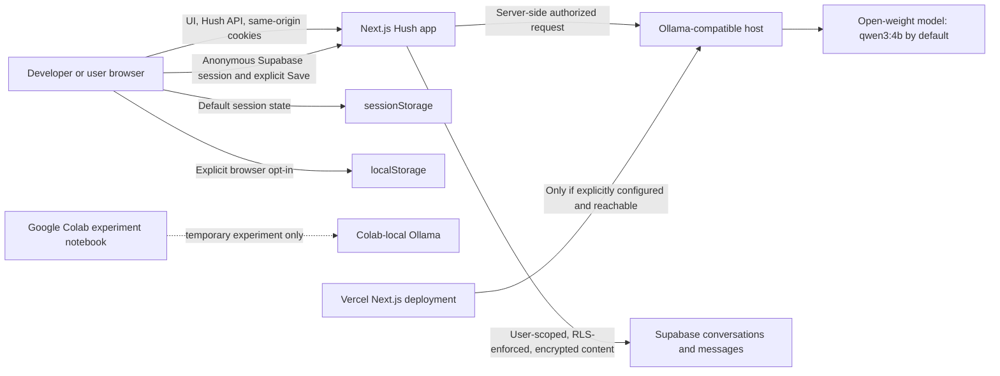

# Hush AI

### Your thoughts. Your space. No identity required.

Hush is an anonymous AI companion for asking questions, exploring ideas, learning, coding, brainstorming, and thinking through decisions. It streams responses from an authorized Ollama-compatible open-weight model and does not use a commercial cloud-model fallback.

**Thought Trails** let you branch from an assistant response and explore a side question without losing the original thread. Each branch inherits only its parent context; turns in sibling branches stay separate.

[](https://nextjs.org/)
[](https://react.dev/)
[](https://www.typescriptlang.org/)
[](https://tailwindcss.com/)
[](https://ollama.com/)
[](https://supabase.com/)

> **Project status:** Core chat and Thought Trails are implemented. Anonymous Supabase auth and explicit conversation sync are present in the code and require a configured Supabase project. Live save/load/delete and cross-user RLS verification are not yet confirmed for this checkout; see [Known limitations](#known-limitations).

## Overview

Hush is designed for people who want to start a conversation without a login screen and explore ideas without being forced into a single linear transcript. A response can become a branch point: follow a tangent, compare alternatives, then return to the parent trail.

The browser keeps conversations in `sessionStorage` by default. Users may instead opt into browser `localStorage`, or explicitly save a conversation and its Thought Trails to Supabase. Supabase anonymous authentication runs without a login/signup flow and scopes saved records to the current anonymous identity. Supabase sync is separate from the browser-storage preference: it is not enabled just by choosing local browser storage.

Saving remotely sends conversation data to the Hush server, which encrypts titles, trail names, and message content with a server-only AES-256-GCM key before writing them through the authenticated Supabase client. This is not end-to-end encryption: the server handles plaintext during save/load. Ollama inference is also performed by the configured Ollama-compatible host; it is local only when the configured host is on the user's own machine.

## Features

- Account-free access; the application creates an anonymous Supabase identity for optional cloud sync without a login/signup screen.
- Streaming chat through Hush's server-side Ollama-compatible adapter.
- Thought Trails with parent message anchors and independent sibling branches.
- Quick Fix, Explain It, Think With Me, and Challenge Me response styles.
- Stop and retry controls, Markdown rendering, and code-copy actions.
- Session-only browser persistence by default and explicit browser `localStorage` opt-in.
- Explicit Supabase save, load, list, and delete UI; requires configured project credentials and schema/RLS.
- Responsive desktop and mobile layouts, including the Thought Trails drawer.
- Health and error states for missing configuration, offline runtime, missing model, timeouts, and failed requests.
- No OpenAI or Anthropic model calls and no cloud-model fallback.

## Screenshots and demo

The repository includes visual design references in the `hush_*` folders, but they are not verified screenshots of the current application. Add current captures here when they are available:

| Landing page | Conversation workspace |
| --- | --- |
| _Add a current application screenshot_ | _Add a current application screenshot_ |

| Thought Trails | Mobile interface |
| --- | --- |
| _Add a current application screenshot_ | _Add a current application screenshot_ |

A live demo URL has not been configured or verified.

## Technology and architecture

- Next.js 15 App Router, React 19, and TypeScript 5.
- Tailwind CSS 3, Lucide React, Zod, `react-markdown`, and `remark-gfm`.
- Ollama-compatible open-weight inference through `ai` and `@ai-sdk/openai-compatible`; the default configured model is `qwen3:4b`.
- Supabase Auth anonymous sessions and PostgreSQL conversation/message storage through `@supabase/ssr` and `@supabase/supabase-js`. Remote sync is explicit opt-in.
- Browser `sessionStorage` by default, with explicit `localStorage` selection.
- Google Colab notebook for isolated, temporary Ollama/model experiments only.
- Vercel is the intended deployment target for the Next.js application; no verified production deployment exists.



The browser calls `/api/chat`, `/api/health`, and `/api/conversations`; it does not call the Ollama host directly. Hush's Supabase server client uses the anonymous user's cookie/session and the public publishable key, not a service-role key. Supabase owner-based RLS remains required.

The Colab notebook is not in the production request path. Colab `localhost` is the Colab VM, not a developer's computer or a Vercel function. Runtime sessions and downloaded model files may expire. A deployed app needs an independently hosted, authorized, network-reachable Ollama-compatible model runtime to generate production responses. No public model endpoint is claimed here.

## Prerequisites

- Node.js 18.18 or newer and npm.
- Git to clone a repository once a public repository URL is available.
- Ollama and the configured model for local real-inference development.
- A Supabase project only if testing anonymous identity and explicit remote save/load/delete.
- Google Colab is optional for model experimentation; it is not required for local development.

## Installation and local development

1. Clone the repository after its owner publishes it. Replace the placeholders with the actual repository and folder names; this workspace currently has no Git remote.

   ```sh
   git clone <YOUR_PUBLIC_REPOSITORY_URL>
   cd <PROJECT_DIRECTORY>
   npm install
   ```

2. Create `.env.local` from the placeholder template without overwriting an existing file.

   **PowerShell**

   ```powershell
   if (-not (Test-Path .env.local)) { Copy-Item .env.example .env.local }
   ```

   **macOS/Linux**

   ```sh
   test -f .env.local || cp .env.example .env.local
   ```

3. Configure the Ollama variables. For local default settings, start Ollama in another terminal and download the configured model:

   ```sh
   ollama serve
   ollama pull qwen3:4b
   ollama list
   ```

4. To enable Supabase session and explicit sync testing, follow [Supabase setup](#supabase-optional-anonymous-sync). Add the project URL, publishable key, and a fresh server-only encryption key to `.env.local`. Supabase is optional for running chat/browser storage; without it, sync controls report an actionable unavailable state.

5. Start Hush and open the URL printed by Next.js (normally `http://localhost:3000`).

   ```sh
   npm run dev
   ```

Check `GET /api/health`; a real streamed chat confirms the configured model can respond through Hush.

## Environment variables

Use placeholders only in shared files. `.env.local` is ignored by Git and must not be committed. Values with `NEXT_PUBLIC_` are intentionally included in browser bundles: they may contain the Supabase project URL and publishable key, but never a service-role/secret key. The sync encryption key and optional Ollama bearer token are server-only.

| Variable | Purpose | Example |
| --- | --- | --- |
| `LLM_PROVIDER` | Provider allowlist; current code supports `ollama` only. | `ollama` |
| `OLLAMA_BASE_URL` | Authorized Ollama-compatible host. Local development defaults to loopback; production must set a reachable host. | `http://127.0.0.1:11434` |
| `OLLAMA_MODEL` | Model used for inference and health checks. | `qwen3:4b` |
| `OLLAMA_TIMEOUT_MS` | Inference timeout in milliseconds. | `120000` |
| `OLLAMA_API_TOKEN` | Optional server-only bearer token for an authorized model host. | `YOUR_SERVER_ONLY_TOKEN` |
| `NEXT_PUBLIC_SUPABASE_URL` | Supabase project URL used by SSR/browser clients. Public project configuration. | `https://YOUR_PROJECT_ID.supabase.co` |
| `NEXT_PUBLIC_SUPABASE_PUBLISHABLE_KEY` | Supabase publishable key; RLS must protect all exposed data. | `YOUR_SUPABASE_PUBLISHABLE_KEY` |
| `HUSH_SYNC_ENCRYPTION_KEY` | Server-only Base64-encoded 32-byte AES-256-GCM key for saved title/message content. | `YOUR_BASE64_ENCODED_32_BYTE_KEY` |

Generate a local encryption key with:

```sh
node -e "console.log(require('node:crypto').randomBytes(32).toString('base64'))"
```

Put the generated value only in `.env.local` or a deployment secret manager. Keep a secure backup: losing or rotating this key without a migration makes previously saved encrypted content unreadable. Never use a Supabase service-role key in the browser or as a substitute for RLS.

For Vercel, configure environment variables in the project settings separately for Preview and Production. Do not copy real values into this README or `.env.example`.

## Supabase: optional anonymous sync

The project code uses Supabase anonymous authentication and the existing `public.conversations` and `public.messages` tables. No migration or SQL setup file is included. The integration expects these columns, as observed by the current application: `conversations(id, owner_id, title, parent_conversation_id, source_message_id, style, created_at)` and `messages(id, owner_id, conversation_id, role, content, created_at)`. Confirm your deployed schema and policies before enabling save.

1. Create or select a Supabase project and enable **Anonymous Sign-Ins** under Authentication settings.
2. Confirm the existing `public.conversations` and `public.messages` tables and owner-based RLS policies are enabled. Policies must scope `owner_id` to the authenticated user (`auth.uid()`). Do not disable RLS or expose a service-role key.
3. Copy the Project URL and publishable key into `.env.local` as `NEXT_PUBLIC_SUPABASE_URL` and `NEXT_PUBLIC_SUPABASE_PUBLISHABLE_KEY`.
4. Generate `HUSH_SYNC_ENCRYPTION_KEY` using the command above. Keep it server-only and back it up securely.
5. Restart the Next.js server. Hush restores or creates an anonymous session without a sign-in screen. Conversations remain in browser storage until the user selects **Save**.
6. Use **Saved** to list remote conversations, load one, or delete it. Confirm save/load/delete success in the UI and Supabase project. Treat a message that the operation was successful as valid only when the API confirms the corresponding database operation.
7. Test isolation with two independent anonymous browser profiles: save under profile A, then try listing/loading the same UUID as profile B. B must receive no row/not-found. Do not test isolation by disabling RLS.

The existing tables were created outside this repository. There is no checked-in migration describing their complete schema, and this README does not recreate or modify them. The current Supabase end-to-end save/load/delete and two-user RLS verification remain unverified for this checkout.

## Google Colab and model experiments

`colab/Hush-Ollama-Experiment.ipynb` runs an isolated Ollama experiment with `qwen3:4b`; it does not implement Gemma specifically. It has no stored cell outputs in this checkout.

1. Open the notebook in Google Colab and choose an available runtime.
2. Select a GPU if available and run the notebook's GPU check.
3. Run cells from top to bottom to install Ollama and required OS utilities and start Ollama inside the Colab VM.
4. Pull `qwen3:4b`, inspect `/api/tags`, and try the notebook's non-streaming and streaming generation checks.
5. Expect runtime expiration and possible loss of downloaded model files. GPU availability and resource quotas depend on Colab.

The notebook deliberately does not create public tunnels or production endpoints. It is not a supported way to connect Vercel to Ollama.

## Deployment

There is no Git remote configured in this workspace and no verified live demo URL. Once the owner selects and publishes the repository:

1. Add the chosen GitHub repository as the `origin` remote and push the reviewed branch. Do not invent a repository URL or replace an existing remote.
2. Import that repository into Vercel as a new project and create a Preview deployment first.
3. Configure the Supabase variables and server-only encryption key only if remote sync is enabled. Configure `OLLAMA_BASE_URL` only when an authorized inference host exists.
4. Open the Preview URL, verify health state and optional sync behavior, and test real streaming only after the inference host is reachable from Vercel.
5. Promote a Preview to Production only after the actual model and Supabase flows have been verified.

Vercel's `127.0.0.1` refers to the Vercel function environment, not the developer's machine, and cannot reach a Colab VM automatically. Without an authorized reachable model host, Hush should report `configuration_missing`; it must not fabricate a response or fall back to a cloud model.

## Privacy and security

- No login/signup screen is required; anonymous Supabase authentication still creates a pseudonymous provider identity and uses session credentials.
- Browser session storage is the default. Browser-local persistence is a separate explicit choice.
- Supabase receives conversation content only after the user chooses **Save**. Titles, trail names, and message content are encrypted by the Hush server before storage, but this is not end-to-end encryption.
- Every Supabase query runs with the anonymous user's session and must remain protected by owner-based RLS. No service-role key is used by this integration.
- Chat prompts are sent through the Hush server to its configured Ollama-compatible host. With local Ollama that host may be the user's own machine; a remote configured host receives the request.
- Deleting a saved conversation removes its saved records through the authenticated API. Clearing the browser session alone does not delete Supabase copies.
- Anonymous auth is not a guarantee of anonymity, and browser/server/network/provider logs may exist outside Hush's control. Do not send sensitive material unless the deployment and providers are trusted.

## Commands and checks

| Command | Purpose |
| --- | --- |
| `npm run dev` | Start the Next.js development server. |
| `npm run build` | Create the production build. |
| `npm run start` | Serve the production build. |
| `npm run lint` | Run the configured Next.js lint command. |
| `npm run typecheck` | Run TypeScript without emitting output. |
| `npm run test:styles` | Live requests for all four styles; requires a running Hush server and a reachable Ollama model. |

There is no generic `npm test` command or configured unit/integration test runner. `test:styles` is not a Supabase test suite.

## Troubleshooting

| Problem | Check and recovery |
| --- | --- |
| Ollama is not running | Start it with `ollama serve`; then refresh Hush health. |
| Model is not installed | Run `ollama list`; pull the configured identifier, currently `qwen3:4b`. |
| Model identifier is invalid | Compare `OLLAMA_MODEL` to `ollama list` and correct the server environment value. |
| AI endpoint cannot be reached | Check `OLLAMA_BASE_URL` from the Hush server's network, TLS, firewall, authorization, and token. Never expose port 11434 directly. |
| Colab runtime disconnected | Restart the runtime, rerun notebook setup, and redownload the model if necessary. Colab sessions are temporary. |
| Supabase credentials are missing | Set both `NEXT_PUBLIC_SUPABASE_URL` and `NEXT_PUBLIC_SUPABASE_PUBLISHABLE_KEY`; restart the Next.js server. |
| Anonymous session cannot be created | Verify Anonymous Sign-Ins are enabled in Supabase Auth and inspect the sanitized browser/API error. |
| RLS rejects or hides a query | Verify the session is present, RLS is enabled, and owner policies compare `owner_id` with `auth.uid()`. Never disable RLS or use service-role credentials to bypass it. |
| Save reports an error | Check Supabase connectivity, required table columns/policies, and server-side `HUSH_SYNC_ENCRYPTION_KEY`; success is not shown unless Supabase confirms rows. |
| Production builds but inference is unavailable | Vercel cannot reach the developer's or Colab's loopback Ollama. Configure a separate authorized host or leave the deployment honestly in `configuration_missing`. |

## Contributing

Before reporting an issue, include the reproducible steps and sanitized logs; never attach `.env.local`, keys, prompts, or private transcripts. Contributions should preserve the Ollama-only model boundary, explicit Supabase save consent, RLS ownership, and current folder structure. Review `AGENTS.md` and the source-of-truth documents, make focused changes, and run the relevant checks. Open a pull request against the repository after its owner configures the GitHub project.

## License

No license file or license declaration is present. No license has been selected; the repository owner must choose and add one before presenting this project as open source. Do not assume permission to reuse or redistribute it.

## Project status and limitations

**Implemented:** anonymous chat UI, four response styles, streaming/stop/retry, Thought Trail branching, Markdown/code copy, browser session/local storage, health states, Ollama adapter, and Supabase anonymous-auth plus explicit save/load/delete code paths.

**Experimental:** Colab notebook model checks; optional Supabase sync until full integration and two-user RLS tests pass.

**Not available:** payment, email, remote file attachment storage, user login/signup, cloud AI fallback, and a verified public production deployment.

**Known limitations:** Supabase table definitions are managed outside this repository, so no migration file is available here; cross-user RLS and end-to-end save/load/delete remain unverified in this checkout. The live Vercel and production inference endpoint are not verified.
